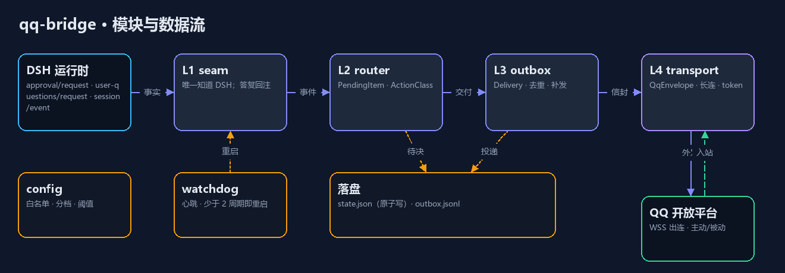
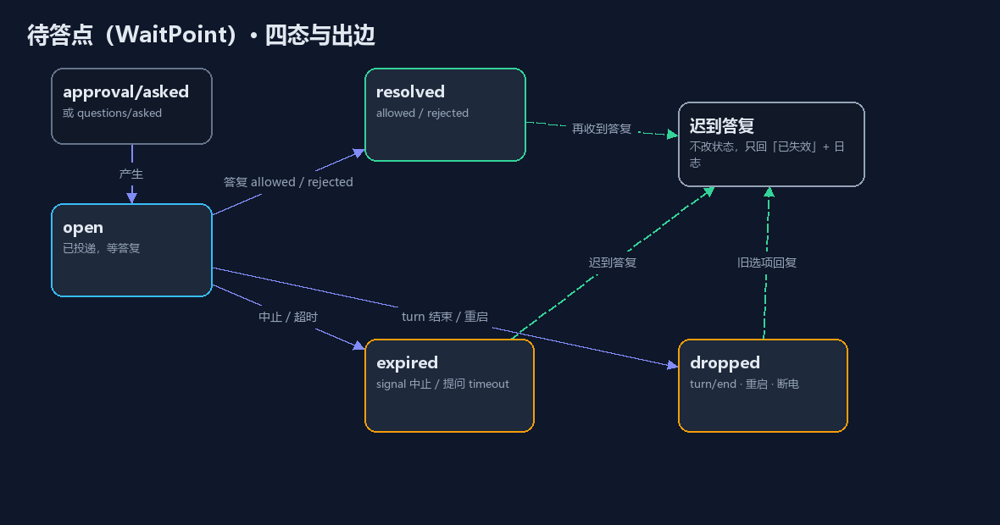
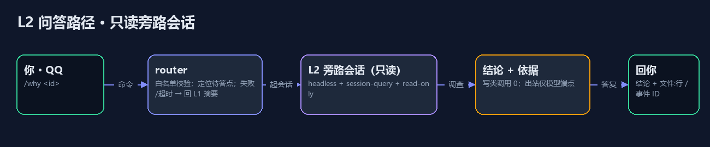

frame: docs/frame/qq-bridge.md

# 架构 · qq-bridge（v6：骨架实测回写）

> **文档状态（2026-10-25）；测试基线以 `docs/build/baseline.md` 为准**：本文件的"实现进度"描述已过期——`/list` `/progress` `/new` `/use` `/wake` `/say` `/why` `/done` `/ans` `/yes` `/no` 全部落地，审计、双通道审批、卡片合并、咨询通道与自动归档也已实现，离线测试 61 套全绿。
> 接缝返回的审批结局必须使用 DSH 的封闭词表 **`allowed-once` / `rejected` / `cancelled` / `unavailable`**；早期误用 `allowed` 曾导致「电脑点允许」与「手机 /yes」两条通道的批准全部失效。
> 进度与证据以 `docs/build/qq-bridge.md`（台账）与 `review-r1…r9.md` 为准。

读者是 `incremental-delivery`：读这一页 + `02-contracts.md` + `03-decisions.md` 就该能开工。
本版按 arch review R1 的结论重写：删掉"计划中存在但没写"的文件、把证据指向真实测试、修正骨架进度。

## 1. 边界按什么切

**主判据 = 数据所有权**（ADR-01）；变更频率只在 transport 内部用（ADR-04）。

| 层 | 拥有什么 | 对谁负责 |
|---|---|---|
| **L1 `seam`** | 两条接缝（`approval/request`、`user-questions/request`）+ `session/event` | 事实 → `Event`；答复 → `SeamOutcome`；`/say` → 注入 |
| **L2 `router`** | `WaitPoint`、`Answer`、`LabelPolicy`、审计 | 要不要告诉你、答复归属、卡片标什么 |
| **L3 `outbox`** | `Delivery`（去重计数、推送闸门） | 送到一次、不重复烦人 |
| **L4 `transport`** | `QqEnvelope`、长连、token、命令解析 | 腾讯协议细节 |

出站 `L1→L2→L3→L4`，入站 `L4→L2→L1`；L4 不得直接调 L1。
**当前实现把 L2/L3 合并进了 `src/app/bridge.js`** —— 目录上仍是两个概念，代码里还没拆文件，见 §9 债 1。

## 2. 跨层只有一种形状

`Event`（ADR-02）。**已落地** `src/core/events.js`：seam 侧用 `approvalEvent` / `questionEvent` 构造，bridge 用 `unwrap()` 兼容裸 request（迁移期）。

## 3. 失败在哪一层被隔离

| 故障 | 隔离点 | 你看到什么 | 验收 |
|---|---|---|---|
| QQ 断网 / token 过期 | L4 熔断，L3 排队 | 延迟到达；待答点仍挂着 | A4（未测：离线补发仅有条数摘要，无逐条重放） |
| 桥接崩 | 外部守护拉起 | 崩的瞬间审批 `unavailable` | A16（**未实现**：无外部守护） |
| 桥接挂死 | 心跳 + 看门狗 | 审批无限等（F11），看门狗重启补齐 | A14（**未实现**：仅 WS 重连，且心跳 41.25s，与 20s 要求冲突） |
| DSH turn 中止 | L1 取消订阅 + L2 标 `dropped` | 旧请求答复回"已失效" | A9a（已实现：signal 中止 → `cancelled`，见 `s17-late`） |
| L2 失败 | 降级 | 回 L1 摘要并标明 | A20（未实现：咨询不可用只回一句话，未做 L1 摘要降级） |
| 断电 / 主动退出 | 启动自检 | 报"异常结束" / 发最后一条 | A13（部分：只报待答作废，不报中断 turn）、A17（已实现：退出前发一条） |

**设计承诺（R1-1 修正）**：桥接**不替用户 settle**。生产路径不传 `timeoutMs`，审批可以无限等；
`timeoutMs` 只存在于测试夹具，**不得**进配置默认值（ADR-18）。提问接缝同理：桥接侧不设过期，`expired` 只由 DSH 侧终止产生。

## 4. 契约

七个：`Event`、`SeamOutcome`、`WaitPoint`、`Answer`、`Delivery`、`LabelPolicy`、`QqEnvelope`。
入选判据：**会被两个以上单元同时读写**。`AuditEntry` 暂不单列（只有 router 写），等第二个写者出现再升格。

## 5. 图







重建：`diagrams/*.json` + `render.py`（Pillow）+ 命令 `python docs/arch/qq-bridge/diagrams/render.py`。
L2 路径图已落地：`/why` 起独立会话、可写、`/done` 后自动归档（见 §8 审计补记）。

## 骨架（L5）

形态＝正常（ADR-07）。**实测状态**（R1-2 修正：不再把"计划"当"已验"）：

| ID | 验什么 | 阈值 | 状态 |
|---|---|---|---|
| S1 | 插件占住 `approval/request` | 连续 5 次不出现 `unavailable` | ✅ 单元级（真 cordis） |
| S2 | 出站到 QQ | 沙箱号 ≤10s 收到，带 id | ✅ 真机 |
| S3 | 入站回注 | 回复后 ≤5s 状态变化 | ✅ 真机（`outcome=allowed`）；**答复命中→resolve 未单独计时** |
| S4 | 重启不重复不误批 | 同 id 重复 0 条；旧答复 0 条生效 | ✅ 脱网（s4-state） |
| S5 | `/say` 后上下文连贯 | 停 2h 后引用停前细节 | ⚠ **代码通、真机未验**（`s5-say` 只证注入调用与确认流程；`agent.inject` 的 UserMessage 形状是推断的） |
| S6 | 审批请求是否带参数 | 打印字段名，二选一记录 | ✅ **已做，结论：不带参数**（`{agent, toolName, callId?, reason?, displayReason?, signal}`）；参数改为按 `callId` 从 `tool/call` 事件反查（ADR-22） |
| S7 | 提问接缝（后加） | 单问题选项/文本都能回 | ✅ 脱网（s5-question） |

**S5 的真机判据未验，这是当前最大的缺口**——它们决定 `/say` 与"卡片能显示什么"两条设计是否成立。

## 验收

### frame 验收 → 真实证据（R1-4 修正：不再写不存在的 fixtures）

| 覆盖 | 证据（可跑） | 状态 |
|---|---|---|
| A1/A6/A25 卡片字段、去重、无评级词 | `test/s2-transport.test.mjs`、`test/s3-label.test.mjs` | ✅ 脱网 |
| A2 答复回注 | `test/s3-loop.mjs`（真机） | ✅ 真机；**≤5s 未单独计时** |
| A9a/A10 迟到与乱序答复 | `s17-late` | ✅ 脱网通过 |
| A11 标注可重放 | `test/s6-label.test.mjs`（三条判据）+ `s3-label`（yes 矩阵） | ✅ 脱网；真机未验 |
| A12/A13 睡眠/断电 | `test/s4-state.test.mjs`（重启作废） | ✅ 脱网；睡眠未测 |
| A14/A16 挂死/崩溃拉起 | `s18-watchdog`（WS 重连） | ⛔ **未实现**：无进程守护；A14 与心跳 41.25s 冲突 |
| A19′/A21 L2 调查 | `s12-consult` / `s15-writes` / `s47` | ✅ 脱网通过（可写、每次写审计、`/done` 归档） |
| A22/A23 `/say` | `s5-say` / `s30-say-text` | ✅ 脱网通过；真机已验 |
| A26 审计 | `s8-audit` / `s41-audit-conservation` | ✅ 已实现（180 天裁剪在启动时调用） |
| A30 停滞 | `s14-notify` / `s23-format` | ✅ 已实现（工具执行中豁免） |

**结论：A1–A30 里真正有证据的是一小半。** 这张表就是当前真实进度。

### L2 五问 → 证据

| 问 | 证据 | 状态 |
|---|---|---|
| 边界（L4 不得调 L1） | 无 arch-lint；`seam/`、`outbox/` 目录尚不存在 | ⛔ 未做 |
| 单一形状（只有 Event 跨层） | 无（Event 未落地） | ⛔ 未做 |
| 失败隔离（离线仍 fail-closed） | 无 | ⛔ 未做 |
| 契约唯一写者 | 人工核对，尚无 grep 断言 | ⚠ |
| 骨架最薄 | S1–S4、S6、S7 绿；S5 未跑 | ⚠ |


## 8. 审计补记（2026-10-24 文档回溯）

两处在实现中新增、01 未记录的能力，现补记：

| 能力 | 说明 | 落点 |
|---|---|---|
| 卡片合并窗口 | `mergeMs`（生产 1500ms）：窗口内多张待答卡片合成一条，兑现 frame C2；窗口内仅 1 张时按原样单发 | `Bridge.#queueCard` / `#flushCards` |
| 唤醒入口 | 不用 `agents.resume`（参数需 composition），改用 `sessionController.resolveAgent(id)` → `{agent}`/`{error}` | `Bridge.wakeSession` |
| 短 id | 所有会话类命令接受 6 位短 id（`session-` 前缀剥离后前 6 位），序号仍可用 | `shortOf()` + `resolveTargetId()` |

**需求级影响**：通知正文（`[标题 · id]` + 本轮摘要）超出 A24 的文案约定。两项均为**新增而非修改**，已提请签字人确认（见台账「文档回溯」）。

## 9. 已知债（骨架期欠下的，按 R1 结论登记）

1. **L2/L3 未拆文件**：都在 `src/app/bridge.js`。拆分触发点：下一片动 L3 时。
2. ~~`Event` 未落地~~ → 已落地；seam 迁移未完成（lib/index.js 仍传裸 request，靠 `unwrap` 兜）。
3. ~~`LabelPolicy` 未落地~~ → 已落地 `src/core/label.js`（三条判据 + 参数反查，ADR-22）；ADR-19 的 reversible 代理作废。
4. ~~**`/say`、`/why`、`/list`、`/progress` 未实现**~~（已全部实现，见顶部状态说明），但**不再静默吞**：收到就回"还没开放"（R1-2 修正）。
5. ~~审计未落地~~ → 已落地 `src/app/audit.js`（JSONL 追加写、五字段、180 天 prune，A26）；`evidenceViewed` 目前恒为 false（`/why` 未实现）。
6. **A2 的 ≤5s 未测量**：S3-loop 只测了端到端 8.7s（含人打字）。
7. **多问题提问让位**（返回 `undefined`）——ADR-20。

## 落盘形状（按真实文件重写）

```
├─ package.json                # dsh-qq-bridge，ESM，无构建（ADR-17）
├─ cordis.patch.yml            # insert: { id: qq-bridge, name: dsh-qq-bridge }
├─ lib/index.js                # 插件入口：注册两条接缝、装配 Bridge
├─ tools/                      # audit-docs / audit-prompts / bb-reset / openid-probe / repair-title
├─ src/
│  ├─ app/
│  │  ├─ bridge.js             # L2+L3 合体：WaitPoint/Answer/LabelPolicy 的编排
│  │  └─ audit.js              # 审计：JSONL 追加 + 180 天裁剪
│  ├─ core/
│  │  ├─ presence.js           # 在场判定（空闲探针：electron / powershell）
│  │  ├─ events.js             # Event 形状与校验（kind 封闭集）
│  │  ├─ sessions.js           # 会话库读取、标题、工作区清单
│  │  ├─ label.js              # LabelPolicy：三条判据 + findToolArgs 反查
│  │  ├─ wait-point.js         # WaitPoint 状态机（内存 + restore）
│  │  └─ store.js              # JsonStore：原子写、坏文件容忍
│  └─ transport/
│     ├─ auth.js               # TokenStore
│     ├─ qq.js                 # QQClient（长连/心跳/被动/主动/撤回）
│     └─ envelope.js           # 卡片渲染 + 命令解析（QqEnvelope）
```

落盘：`%LOCALAPPDATA%\qq-bridge\state.json`（Q11）——含 `version`/`waitPoints`/`deliveries`/`interruption`/`mode`（打扰模式）/`push`（当日主动推送计数）/`notices`（通知预算）/`newSessions`（新建配额）/`consults`（隐藏咨询会话）/`activeTurns`（未闭合 turn，用于 A13）；审计 `state.audit.jsonl`（180 天裁剪）；运行日志 `bridge.log`（JSONL，5MB 轮转）。

## §10 未实现项（如实记录，2026-10-25）

| 项 | 状态 | 说明 |
|---|---|---|
| A7 重启后 ≤5 分钟恢复 | 未实现 | 依赖常驻策略，桥接自身只做了 WS 重连 |
| A14 挂起 ≤20s 恢复 | 未实现（且与协议冲突） | 心跳 41.25s，`recoverIfStale` 按 2 周期 ≈82.5s；A14 的 20s 无法满足，需改签 |
| A16 外部守护拉起 | 未实现 | 没有计划任务/托盘/自启 |
| W9 日志轮转 | ✅ 已实现 | `src/app/log.js`：`bridge.log` JSONL，超 5MB 轮转为 `.1/.2/.3`（`s54`） |
